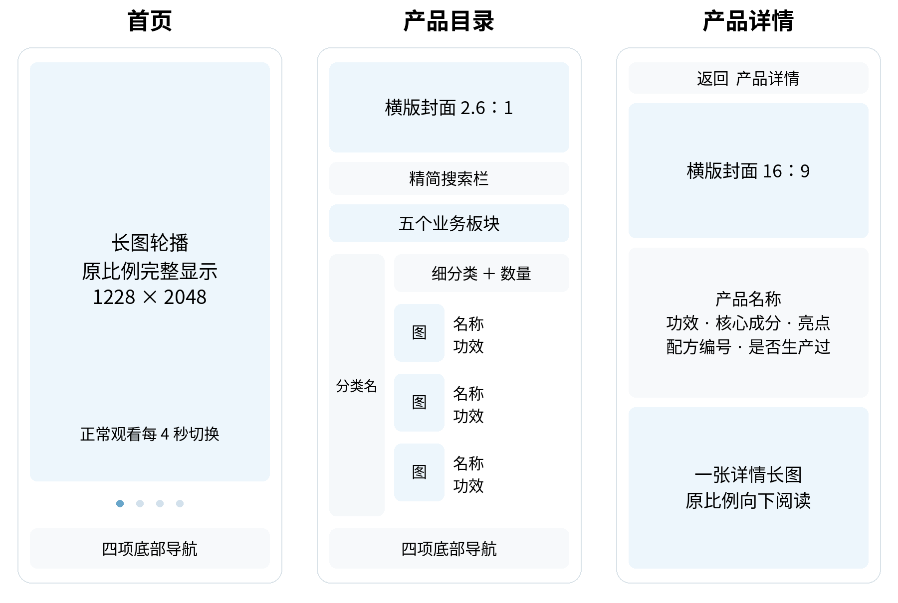
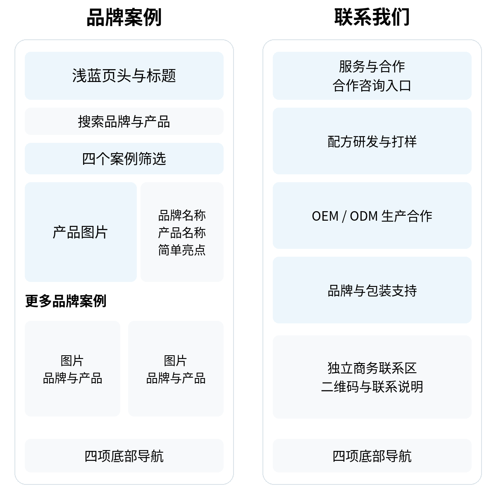

# 化妆品产品平台设计稿细则与需求汇总

版本 1.0　整理日期 2026年11月22日

## 1 文档用途与确认口径

本文件用于交接已经讨论过的页面设计，供产品、视觉设计和前端人员按同一标准继续完善。内容包括最终页面结构、文案、产品分类、字号配色、图片比例、点击与滚动规则，以及历次修改的取舍。交付包同时保留最新可点击原型，便于对照查看。

本次整理的对象是化妆品通用产品展示平台。微肽生物是当前原型使用的示例企业，不能把企业名称、标识和服务内容当成所有企业固定不变的设计内容。

本文采用三种标记。**最终要求**来自用户最后一次明确表达，覆盖之前冲突的说法；**原型现状**描述本包 HTML 实际呈现和已具备的交互；**需对齐项**指出要求与原型、或素材与展示之间尚存的差异。没有讨论过的内容，不视为已确认设计。

本文件不包含后端架构、数据库表、接口协议或研发排期。页面中涉及“能修改图片和文案”的描述，仅指内容可替换要求。

### 1.1 设计依据

| 标记 | 依据 | 使用范围 |
| --- | --- | --- |
| U | 本次会话的全部设计要求与更正 | 页面目标、最终文案、分类及取消项 |
| P1 | prototype/src/app.html 与 app.js | 页面结构、点击、搜索、详情和返回行为 |
| P2 | prototype/src/catalog-data.json | 当前分类、细分类与示例内容 |
| P3 | prototype/src/app.css 与 cases.css | 产品目录、详情、导航及案例视觉参数 |
| P4 | prototype/src/company.html 与 company.css | 首页轮播、长图比例及圆点 |
| P5 | prototype/src/contact.html、contact.css、contact-data.json | 服务与合作版式、文案及联系区 |
| P6 | prototype/src/device.css 与 assets | 手机预览外框与实际图片素材 |

原型基线为本包 prototype/index.html。最新一次调整是联系我们页面的文字精修。本文中的原型数值均依据上述文件核对，不以早期截图中的旧数值替代。

## 2 最终整体设计

### 2.1 使用目的

让老板、内部业务团队和品牌客户快速了解企业产品、基本功效与配方编号、品牌案例，以及企业能提供的合作服务。页面以浏览和介绍为核心，产品查找路径保持清楚、直接。

早期参考美团的“上部品牌展示、下部分类目录”结构；最终形成四个独立底部页面。采用用户指定的花叔设计方向进行过迭代后，以本次确定的原型和用户选中的案例版型为设计基线。

### 2.2 固定底部导航

| 顺序 | 名称 | 图标语义 | 页面作用 |
| --- | --- | --- | --- |
| 1 | 首页 | 房屋 | 直接观看竖版产品长图轮播 |
| 2 | 产品目录 | 四宫格 | 按业务板块、分类和细分类浏览产品 |
| 3 | 品牌案例 | 公文包 | 展示品牌客户使用的产品及简短亮点 |
| 4 | 联系我们 | 电话 | 展示合作服务图片与联系二维码 |

导航文字固定为“首页、产品目录、品牌案例、联系我们”，不使用“公司介绍”“意向清单”等旧名称。图标在上、文字在下，四个入口等宽。选中状态采用淡蓝色图标底和稍重字重，文字仍为黑色。导航固定在底部，长内容在上方区域滚动。[U，P1，P3]

### 2.3 整体视觉方向

大面积使用白色；浅蓝作为选中背景、局部图形和轻量装饰。早期深蓝大色块已经被后续要求替代。可少量使用很浅的薄荷色服务卡片背景，但不能改变整体白底、轻蓝的视觉重心。

页面可编辑文字全部为黑色。用字号、字重、行距和间距建立层次，不用灰字和蓝字区分正文。用户上传海报内部已有的文字与色彩保留原素材，不在页面上重新改色。

字号保持精致，避免大标题、粗黑长句压满屏幕。缩小的是文字视觉体量，不应让导航、返回和关闭等触控区域变得难以点击。

图 1 为区域顺序示意，不是逐像素截图。具体尺寸与字号以各页面细则和参数表为准。

## 3 首页设计细则

### 3.1 页面内容与结构

进入首页直接显示轮播长图；不在长图上方增加企业介绍标题、独立 Logo 栏、介绍卡片、数据条或重复说明文字。页面结构为“长图展示区、圆点指示区、固定底部导航”。企业标识已经出现在上传的海报中，不再叠加一行品牌名。[U，P1，P4]

最终要求是配置多于两张长图。当前原型使用用户上传的四张，依次为光感微珠素颜霜、三曜凝时精华油、三相双仓抗醇精华、双萃奢润精华粉底液。四张原始图片均为 1228 × 2048 px，显示时按宽度等比缩放，不横向拉伸，不为了铺满容器裁掉文案或瓶身。[P4，P6]

400 px 显示宽度时，完整图片约高 667 px；360 px 宽时约高 600 px。屏幕可用高度不足时，当前海报允许纵向阅读。不能为了让整张图一次塞进屏幕而把内容强行压扁。

### 3.2 轮播与圆点

| 状态 | 视觉与交互规则 |
| --- | --- |
| 正常观看 | 每隔 4 秒切换下一张，最后一张结束后回到第一张 |
| 点击圆点 | 立即切换到对应图片，更新当前圆点 |
| 左右滑动 | 手动切换图片，圆点与实际图片同步 |
| 手指按住或正在操作 | 暂停自动切换，避免与手势抢控制 |
| 向下阅读当前长图 | 暂停轮播，保留当前图；回到顶部后恢复 |
| 离开首页或页面转入后台 | 暂停轮播，避免后台继续滚动 |
| 返回首页 | 保留当前图片位置；满足播放条件后继续 |
| 仅有一张图的兼容状态 | 显示一个圆点，不进行无意义的自动切换 |
| 没有图片 | 不展示损坏图片和多余圆点；正式素材至少提供三张 |

圆点紧接图片区域下方，居中排列。普通点约 6 px，当前点约 7 px，并有很浅的外围强调。点的视觉尺寸与可点击区域分开，不能只让 6 px 的圆点本身响应点击。[P4]

原型的 4 秒是正常观看时的轮播间隔。阅读暂停、手势操作和浏览器后台状态会延后下一次切换；这是为了让用户看完长图，并非取消自动播放。

### 3.3 首页不再保留的内容

旧的“公司介绍”页签改为“首页”；早期额外首页顶部区域已移除。之前尝试的企业数字横条不作为首页独立模块恢复。相关品牌文案可用于后续制作海报，但不得再次叠加成首页标题栏。

## 4 产品目录设计细则

### 4.1 区域顺序

从上到下依次为横版封面图、精简搜索栏、五个一级业务板块、左侧分类与右侧产品列表、固定底部导航。原“微肽生物”独立标题行删除，以横版封面图承担品牌展示功能。[U，P1]

封面保持横版，较最初版本适当增加高度。当前展示比例约 2.6∶1，400 px 宽时约高 154 px。原素材为 2172 × 724 px，等比铺满这个展示框时会裁掉左右两侧的一部分，需要把主体和重要文案放在横向安全区域。[P3，P6]

当前封面文字为上行“医研共创为根基”、下行“功效护肤超级工厂”。上行小字号，下行稍重，整体左对齐。不要另起企业名称行；换用带完整文字的封面图时，应检查是否与页面文字重复。

### 4.2 搜索栏

搜索框宽度随页面，左右约 15 px 留白，高度 36 px，浅底、细边、约 10 px 圆角。左侧为小搜索图标，中间输入文字，右侧在有输入时显示清空按钮。提示文案为“搜索产品 / 编号”。[P1，P3]

搜索范围是当前一级业务板块，并非五个板块全站搜索。原型支持产品名称、英文名、配方编号、分类名称、细分类名称匹配。不能把数据文件中的“成分”提示词理解为已经支持成分全文搜索；当前实际搜索不包含核心成分和完整功效正文。[P1]

开始搜索后，右侧切换为搜索结果状态，隐藏细分类筛选行，并显示“找到 N 个产品”。左侧分类不出现误导性的选中强调。清空搜索后恢复先前分类及细分类，并回到结果区域顶部。

### 4.3 一级业务板块

顺序固定为：**护肤、冻干、二类、洗护、外贸**。每项均带小图标，图标在上、文字在下，五项等宽。早期“妆字号、械字号、外贸、品牌案例”这组导航已被替代，品牌案例独立放到底部导航。[U，P1，P2]

护肤使用水滴类图标，冻干使用雪花类图标，二类使用盾牌医疗类图标，洗护使用泡泡类图标，外贸使用地球类图标。图标采用统一的线性风格，避免混用实心大图标、表情符号和不同粗细的图标。

### 4.4 左侧分类与数量

左侧固定约 80 px，使用极浅底色，与白色右侧列表区区分。分类名称单行、居中，选中分类使用浅蓝色圆角底。不能因为数量而加宽左栏，也不能把“分类名称”和“产品数量”拆成上下两行。[U，P3]

用户最后选择第 10 个数量展示方案。当前原型的落实方式是：**左栏只放分类名；数量放在右侧细分类筛选行的末端**，以小字“N款”显示。右侧产品区域不因数字挤压而变窄。不要恢复“净澈清洁 共3款”这样的重复大标题。

数量表示当前分类的全部产品数，不随“洁面”“卸妆”等细筛选改变。例如净澈清洁共 3 款，点击洁面后可能只显示 1 款，右上角仍显示 3 款。搜索状态另外显示搜索结果数。占位记录和案例不计入产品数量。[P1，P2]

### 4.5 细分类筛选

右侧产品上方放“全部”和具体细分类按钮，例如“全部、洁面、卸妆”。按钮单行横向排列，过长时横向滑动，不挤占左栏。切换左侧分类后，细分类回到“全部”。

基础维稳使用“全部、精华水、乳液、膏霜”。其他分类沿用相同结构；目前没有配置具体细分类的项目，只显示“全部”，不根据名字临时编造新的细分名称。完整分类与现有筛选见第 5 节及分类清单。[U，P2]

### 4.6 产品条目

每条产品为“左图、右文”。文字仅两行：第一行产品名称，第二行简短功效。配方编号不放在目录条目中，进入详情再显示。长名称和长功效摘要各自单行省略，不把一条产品撑成多行大段内容。[U，P1]

产品图为方形圆角图，常规预览宽高 96 px，窄屏可缩至 88 px 或 76 px。整条均可点击。产品之间使用间距，不增加横向分隔线。图像、名称与功效上下关系固定，不能改回价格、配方编号与按钮混排的商品列表。

### 4.7 浏览记忆与空态

在一级板块之间切换，原型会分别保留分类、细分类、搜索内容，以及左侧分类栏与右侧列表各自的纵向滚动位置。切换具体分类时，清空搜索、选中“全部”，右侧回到顶部。进入详情再返回，原列表位置保留。[P1]

没有产品时显示明确的空态，保留分类导航和筛选结构；搜索无结果时提示“没有找到相关产品”，并提供清空入口。正式展示中空分类可以提示“该分类暂无展示产品”，不应制造虚假的占位产品或把占位算入数量。当前原型的“资料待补充”属于示例空态提示，不能写进已经有完整资料的产品详情。

## 5 最终分类与细分类

### 5.1 一级板块与左侧分类顺序

下表为最后一次修改后的有效分类。护肤共 12 类，冻干 9 类，二类 11 类，洗护 4 类，外贸 7 类，共 43 类。身体护理已从洗护移动到护肤末尾。[U，P2]

| 板块 | 左侧分类顺序 |
| --- | --- |
| 护肤 | 净澈清洁、基础维稳、功效护肤、电商爆品、创新剂型、功效水光、以油养肤、眼部专项、底妆专项、面膜棉片、院线护理、身体护理 |
| 冻干 | 冻干粉、冻干絮、冻干球、冻干油、冻干乳、冻干微球、冻干冰晶、冻干面膜、冻干眼膜 |
| 二类 | 防晒清洁、重组胶原蛋白、重组贻贝蛋白、透明质酸钠、生物多糖、海藻糖、生物玻璃、眼部护理、私密护理、鼻腔护理、其他 |
| 洗护 | 洗发护理、护发修护、头皮护理、沐浴清洁 |
| 外贸 | 净澈清洁、多肽抗老、蓝铜肽、视觉爆款、以油养肤、身体头皮、面膜系列 |

“二类”是最终板块名称，不再用“医用”或“械字号”作该导航名称。其分类也不重复添加“医用”前缀。外贸的“身体头皮”仍保留，不能因为洗护的身体护理移位而一并删除。

### 5.2 已有具体细分类的项目

| 板块与分类 | 筛选按钮顺序 |
| --- | --- |
| 护肤 净澈清洁 | 全部、洁面、卸妆 |
| 护肤 基础维稳 | 全部、精华水、乳液、膏霜 |
| 护肤 电商爆品 | 全部、便携单品、套组 |
| 护肤 以油养肤 | 全部、精华油 |
| 护肤 面膜棉片 | 全部、面膜、棉片 |
| 护肤 院线护理 | 全部、凝膜、护理乳 |
| 二类 防晒清洁 | 全部、防晒、清洁 |
| 外贸 净澈清洁 | 全部、洁面、卸妆 |
| 外贸 以油养肤 | 全部、精华油 |
| 外贸 身体头皮 | 全部、身体、头皮 |

其他分类当前只有“全部”。这一点属于原型内容现状，尚不等同于每个业务分类都已经完成细分规划。

## 6 产品详情设计细则

### 6.1 内容顺序

详情从上到下依次为返回栏、16∶9 横版封面、产品名称、功效、核心成分、产品亮点、配方编号、是否生产过、1 张详情长图。六类产品信息完整展示，不能退回早期“只有图片、名称、配方编号”的极简版本。[U，P1]

顶部返回栏标为“产品详情”。横版封面宽度撑满内容区，高度按 16∶9 计算；封面中的产品和关键文字必须在可见范围内。下方文字用清晰标签组织，标签与正文错开字重和字号，不使用大面积深色底。

产品名称允许自然换行。核心成分用短语或清晰分隔的成分名称；产品亮点宜 2—4 条短句。配方编号有独立复制入口。“是否生产过”用“已生产”或“未生产”明确表达；原型对未知值提供“待确认”回退，未知资料不伪装成真实生产记录。

### 6.2 已填写的示例

以下是原型“轻盈卸妆油”的现有内容，用于说明版式承载量，不代表已确认的企业产品资料。[P2]

| 信息项 | 示例内容 |
| --- | --- |
| 产品名称 | 轻盈卸妆油 |
| 功效 | 帮助溶解日常彩妆及防晒残留，清洁后保留柔润肤感，适合日常卸妆。 |
| 核心成分 | 辛酸/癸酸甘油三酯、PEG-20 甘油三异硬脂酸酯、霍霍巴籽油、生育酚 |
| 产品亮点 | 流动油质便于全脸均匀延展；遇水乳化便于冲洗清洁；按压泵头方便控制使用量 |
| 配方编号 | CL-001 |
| 是否生产过 | 已生产，当前为模拟状态 |

用户明确要求产品详情填写示例，不出现整页“待补充”。当前示例产品已填写上述字段，同时保留“示例资料”和模拟生产状态说明。正式产品替换时，图片、功效、成分、编号及生产状态必须属于同一产品。

### 6.3 详情长图与返回

信息区下方仅放一张长条图片，按原比例显示完整内容，不切成多张图。长图与信息区连续纵向阅读，底部不叠加购买栏或意向清单。当前示例使用同一张系列长图，不能误认为每个产品已有独立详情海报。[P1，P2]

点击返回关闭详情并回到原列表位置；关闭后不重新选第一分类。电脑预览也支持按 Esc 关闭详情。复制失败时提供可选中文字的窗口，不能只显示“复制成功”而实际没有复制。打开详情期间，背景导航不响应点击。

## 7 品牌案例设计细则

### 7.1 选定版型

沿用用户选定图片的结构：浅蓝摄影感顶部、标题和副标题、精简搜索框、案例筛选、一个横向重点案例、下方双列“更多品牌案例”、底部导航。白色为主体，浅蓝仅作背景和局部点缀。[U，P1，P3]

品牌案例与联系我们的区域结构见文末图 2，便于对照两个页面的组成与顺序。

标题为“品牌案例”，副标题为“携手品牌，共创高功效产品”。搜索提示为“搜索品牌、产品或功效案例”。案例是产品部开发并被品牌客户使用的产品展示，不把没有依据的销量、增长率或医院覆盖量作为装饰数字。

### 7.2 筛选名称与顺序

最终只保留：**精选案例、冻干案例、二类案例、外贸案例**。护肤案例和洗护案例已经删除；“医用案例”改为“二类案例”。删除的是案例页的分类及对应示例，不是产品目录的护肤和洗护板块。[U，P2]

当前原型“精选案例”展示全部三条保留的演示案例，结果中的第一条放大展示，其他条目进入双列网格。它目前不是另一个独立维护的精选集合。分类中只有一条案例时，隐藏“更多品牌案例”标题与空网格。[P1]

### 7.3 重点案例卡片

常规比例为左图约 61%、右文约 39%；较窄屏幕约为 57% 和 43%。左侧为产品图片，右侧从上到下仅显示：品牌名称、产品名称、简单亮点介绍。取消“客户品牌”“产品类别”“开发产品”等重复标签，取消信息行分隔线和装饰性小图标。[U，P1，P3]

品牌名称约 14 px，产品名称约 12 px，亮点说明约 11.5 px。文字可以换行，但不能把卡片塞成说明书。亮点建议 1—2 句，优先说明产品组合、剂型或系列特点。

原型示例为“客户品牌 C / 冻干修护组合 / 冻干粉搭配溶媒，呈现成套产品组合”。示例品牌与产品图片应整体替换，不能仅改品牌名而留下不对应的图片。

### 7.4 更多案例与点击行为

更多案例以两列排列，列间小间距，卡片上部为横图，下部为品牌名称、系列标签与产品名称。不能恢复原先六个案例分类，也不要把已删除的护肤和洗护示例再次填回列表。

搜索作用于当前选中的案例筛选范围，支持品牌名称、产品名、简短亮点及现有案例描述。点击清空按钮或空态“重新查找”时，当前原型回到“精选案例”；手动删完输入文字则保留当前案例分类。这与产品目录清空后保留分类的行为不同，应在交互对照时分别检查。[P1]

点击案例当前可打开详情弹层，显示图片、名称、品牌、系列说明和案例编号。用户最后提出的三要素精简已经落实到所标注的重点案例信息区；若希望连详情弹层也只剩三要素，应在下一轮明确，不将当前额外编号当成必需展示信息。

## 8 联系我们设计细则

### 8.1 页面组成

底部导航保持“联系我们”，页面内标题使用“服务与合作”。顶部有简短引导文案和“合作咨询”按钮。正文为纵向服务图片列表，最下方是独立商务联系区与二维码。让访客先知道企业能做什么，再找到联系入口。[U，P5]

服务内容未来以图片形式展示，因此版式应允许替换成真正的服务图片。服务图完整按自身比例显示，不能把所有长图强制裁成同一高度。当前没有图片时，使用现有浅色文字卡片作为版式示例。

### 8.2 当前服务文案

| 区域 | 文案 |
| --- | --- |
| 页面标题 | 服务与合作 |
| 标题说明 | 从产品想法，到成品落地 |
| 服务区标题 | 我们能为你做什么 |
| 第一张服务卡 | 配方研发与打样；研发与共创；让产品想法 / 成为可用样品；配方定制 · 样品开发；应用测试 · 方案优化 |
| 第二张服务卡 | OEM / ODM 生产合作；生产与交付；从样品确认 / 到成品交付；包材协同 · 生产灌装；成品交付 · 项目跟进 |
| 第三张服务卡 | 品牌与包装支持；品牌与产品；形成清晰的 / 系列产品形象；产品规划 · 包装设计；系列开发 · 资料协同 |
| 联系区标题 | 聊聊你的产品想法 |
| 联系区说明 | 配方打样、生产合作、品牌开发，欢迎沟通。 |
| 联系标签 | 商务合作 |
| 联系方式说明 | 扫码添加企业微信；沟通具体合作需求 |

以上服务文案来自当前原型，属于服务展示示例。企业应按实际能提供的服务替换文字及图片，避免把示例能力当成所有企业共有能力。[P5]

### 8.3 精修后的字号与留白

用户最后反馈联系我们页面文字偏大，因此本包采用最新精修值：页头标题 17 px；服务卡主文案 17 px、常规字重，窄屏 16 px；联系区与弹窗标题 14 px；服务说明约 11.5 px；卡片下方标题约 11 px。不要恢复此前 23 px 的服务大文案。[U，P5]

页头左右约 18 px 留白，正文左右约 17 px，服务卡之间约 12 px。示例服务卡为 3∶2、约 13 px 圆角。卡片主文案行高约 1.6，说明行高约 1.75，使小字保持清楚。

### 8.4 二维码与点击

二维码独立放在联系区，不烘焙进每一张服务图片。当前没有真实二维码，因此展示清楚标明的二维码位置示意，不能把装饰图标说成可扫描二维码。[P5]

点击顶部“合作咨询”或联系区“查看二维码”，打开同一个联系弹层。配置真实二维码后，提供放大和保存二维码入口；如提供微信号、电话、邮箱，可按实际内容显示复制或联系入口，未提供的入口隐藏。它们是当前原型支持的可选内容，不要求为了凑齐而编造联系方式。

点击服务图打开大图预览；点击关闭、返回浏览或遮罩可回到原页面，电脑预览也支持 Esc。弹层标题和正文同步使用精修字号，不能在弹层中突然放大一档。长服务图在弹层内可以纵向滚动，保持原比例。卡片内二维码区域约 132 px，窄屏约 120 px；真实二维码放大后约 260 px，并以弹层宽度为上限。

## 9 统一视觉参数

### 9.1 颜色与文字层级

| 项目 | 当前基准 | 用法 |
| --- | --- | --- |
| 页面主背景 | #FFFFFF | 四个页面和详情主体 |
| 全部可编辑文字 | #000000 | 标题、正文、标签、导航、输入提示 |
| 轻量选中底 | #EDF6FC | 导航图标、筛选、复制按钮 |
| 左分类栏底 | #F5F8FA | 分类区与右侧白色列表区区分 |
| 细边与分区线 | #E6EDF2 附近浅色 | 搜索边框、导航边界，不用于产品分隔线 |
| 蓝色点缀 | #4888B5 附近 | 图标与焦点装饰，不用于正文 |
| 服务卡底色 | #EAF4FC、#F0F5F8、#EDF5F5 | 浅蓝、浅银、浅薄荷 |

当前案例选中标签仍使用 #4E8BDB 的较亮蓝底，文字为黑色；这是原型现值。若下一轮进一步统一成更浅的蓝，应作为设计调整处理，不能在交接中悄悄改成其他数值。[P3，P5]

### 9.2 字号与尺寸

| 组件 | 文字或图标 | 布局基准 |
| --- | --- | --- |
| 底部导航 | 文字 11 px；图标 18 px | 高 58 px 加底部安全区；四等分 |
| 业务板块 | 文字 11.5 px；图标 18 px | 整行高 50 px；五等分 |
| 左侧分类 | 文字 11.5 px | 宽 80 px；单项至少约 48 px |
| 细分类按钮 | 文字 11.5 px | 间距 6 px；圆角约 7 px |
| 分类数量 | 文字 11 px | 固定在右侧筛选行末端，不换行 |
| 产品名称 | 13 px，中等字重 | 单行省略 |
| 产品功效摘要 | 11.5 px，常规字重 | 单行省略 |
| 产品目录搜索 | 输入 13 px，提示 12.5 px | 搜索框高 36 px |
| 触屏搜索输入 | 输入 16 px | 原型针对触屏单独处理；提示仍保持精致 |
| 产品详情标题 | 18 px，中等字重 | 可换行 |
| 详情字段 | 标签 11.5 px，正文 12.5 px | 标签列约 66 px；内容自适应 |
| 案例页主标题 | 21 px | 原型当前值，不等同于所有页面统一字号 |
| 案例大卡 | 品牌 14 px；产品 12 px；亮点 11.5 px | 圆角 12 px |
| 联系页主文案 | 17 px；窄屏服务文案 16 px | 含页头标题；服务主文案减轻字重 |
| 联系区与弹窗标题 | 14 px | 与服务主文案拉开层级 |

以上为当前原型的 CSS 像素值，用于同宽度对照。不要将网页 11 px 直接复制为文档印刷字号，也不要通过整体缩放页面来制造“精致感”。[P3，P5]

### 9.3 手机预览与窄屏

桌面使用 HONOR 400 风格的手机外框，屏幕区域约 360—400 CSS px 宽，外框只用于预览。手机访问时去掉模拟外壳，页面使用真实屏幕宽度。底部导航保留安全区空间，最后一张图或最后一条产品不能被遮住。[P6]

窄屏优先缩小局部图片、调整内边距，不增加左栏宽度。特别检查重组胶原蛋白、重组贻贝蛋白等较长分类名，以及外贸品牌英文名。若显示省略，点击后的内容仍应清楚标识所属项目。

## 10 图片与素材交付规则

| 素材 | 当前或建议尺寸 | 展示方式 |
| --- | --- | --- |
| 首页长图 | 当前原图 1228 × 2048 px | 全宽等比，完整显示；至少三张，现有四张 |
| 产品目录封面 | 当前 2172 × 724 px | 容器约 2.6∶1，允许安全裁切，重要内容居中保护 |
| 产品列表图 | 建议方形；原型使用示意包装图 | 方形圆角图；每个产品应有对应图片 |
| 产品详情封面 | 16∶9；建议 1600 × 900 px | 横版全宽，不裁掉产品和文字 |
| 产品详情长图 | 当前示例 793 × 1983 px；高度按内容 | 只用一张，原比例纵向阅读 |
| 案例顶部背景 | 当前 960 × 320 px | 浅蓝摄影感背景，保留标题可读性 |
| 案例产品图片 | 当前主要约 960 × 436 px | 大卡优先完整呈现，网格保持约 2.2∶1 |
| 服务介绍图片 | 建议常规 1200 × 800 px，也可长图 | 按实际图片比例显示，点击放大 |
| 联系二维码 | 清晰正方形原图；建议至少 600 × 600 px | 保留白色边界，支持放大，不做艺术裁切 |
| 企业 Logo | 当前素材 595 × 199 px | 保持比例并缩小使用，不增设顶部品牌栏 |

表中“当前”是素材事实，“建议”是交付尺寸建议。首页四张 JPEG 原图必须保留，不能用早期示例长图覆盖。素材目录仍有旧护肤、洗护案例图片，它们是未启用的历史素材，并不代表页面要恢复对应案例。

服务图片将来替换文字示例卡时，要连同图片说明一起检查，避免同一句标题在图内和图外重复得过于密集。二维码必须用企业提供的真实原图；不能从聊天截图中截取模糊二维码作为最终资料。

## 11 品牌文案与历史数字

### 11.1 已讨论的品牌文案

“医研共创为根基　功效护肤超级工厂”已用于当前产品目录封面。原“产品开发中心”“一册看见，更多可能”被替换，不再恢复。

用户随后给出的企业介绍文案为：

- 妆械联合一站式OEM/ODM/OBM
- 专注医美术后修复，更是电商爆品制造者
- 4大生产基地、4大联合专家团队、150+医疗器械、10000+储备配方

这些文字是用户提供的企业介绍素材口径。由于后续首页改为纯长图轮播，它们不再作为页面独立数字条强行出现；需要时可用于制作企业服务或介绍图片。换成其他企业时，应使用该企业自己的内容。

### 11.2 已被替代的数字与结构

早期“4 业务板块、26 产品分类、39 演示资料”的统计布局，以及参考图中的“10000+、100+、100+、60+、4大”数字条，均不能当作当前通用平台的固定信息。当前分类数量来自最后确认的分类表，企业业务数据来自企业正式素材，两种数量不要混在一起。

## 12 历次修改的最终取舍

本节把多轮对话按设计主题归并。完整逐项对照另见“需求对照清单.csv”；同一位置有多次修改时，后面的最终要求覆盖前面的旧说法。

| 主题 | 历史过程 | 最终采用 |
| --- | --- | --- |
| 产品形式 | 展示公司产品的 H5 或小程序，先做 HTML 原型 | 保留可点击 HTML 作为本阶段设计载体 |
| 参考布局 | 美团上部企业介绍、下部左右分类列表 | 四底部页面，目录保留左右分类结构 |
| 企业名称 | 删除最顶部素研生物；采用微肽 Logo；Logo 再缩小 | 当前微肽是示例企业，取消重复顶部品牌行 |
| 第一轮业务导航 | 产品目录、公司介绍、意向清单；改妆字号等 | 一级业务板块采用护肤、冻干、二类、洗护、外贸 |
| 颜色 | 参考绿色和蓝色，曾有深蓝方案 | 白底为主、少量浅蓝；可编辑文字黑色 |
| 公司介绍 | 介绍内容与统计，后来改为图片展示 | 名称改首页；直接长图轮播 |
| 首页图片数量 | 一张以上、计划五六张，再改多于两张 | 正常配置至少三张，当前四张；兼容单张 |
| 首页播放速度 | 轮播自动播放 | 4 秒自动切换，阅读或操作时暂停 |
| 产品目录顶栏 | 微肽生物文字行 | 横版封面图，适当增加高度 |
| 产品搜索 | 较大搜索栏 | 精简小搜索栏，位置和交互保留 |
| 一级板块顺序 | 护肤、冻干、洗护、医用、外贸 | 护肤、冻干、二类、洗护、外贸 |
| 品牌案例位置 | 曾在一级业务板块内 | 独立底部第三项 |
| 产品列表 | 图片、名称、配方编号等早期组合 | 图片加两行文字：名称、功效 |
| 产品分隔 | 条目下有横线 | 去掉横线，使用间距 |
| 数量展示 | 分类标题、左栏两行、不同方案 | 采用第 10 个方案；左栏名，右筛选行末端小数量 |
| 产品详情 | 早期只放图、名称、配方编号 | 16∶9 封面、六项信息、1 张长图，填写示例 |
| 护肤分类 | 定向功效、高浓度、贵妇膏霜等多个历史版本 | 采用第 5 节最新 12 类，不拼接旧版本 |
| 医用命名 | 类名前加医用，再删前缀 | 板块改二类，采用最新 11 类 |
| 外贸分类 | 清洁、水、乳、液、油、霜、膜、棉片 | 采用最新 7 类 |
| 身体护理 | 在洗护下面 | 移到护肤末尾；外贸身体头皮保留 |
| 案例版型 | 请求五个图片方向，之后选定参考图 | 浅蓝顶部、重点横卡、双列更多案例 |
| 案例分类 | 曾含护肤、洗护、医用等 | 精选、冻干、二类、外贸；删除护肤及洗护案例 |
| 案例卡片文字 | 客户品牌、产品类别、开发产品等字段标签 | 品牌名称、产品名称、简短亮点三个内容 |
| 联系我们 | 早期底栏去留讨论，之后明确联系页 | 服务图片展示加独立二维码 |
| 全站字号 | 整体偏大，底部导航尤其突出 | 保持紧凑字号；联系页最后单独精修 |
| 项目定位 | 微肽产品展示；询问是否叫化妆品产品管理 | 通用化妆品产品平台，微肽只是示例 |
| 交付方式 | 多次要求可点预览、HTML 和静态包 | 同时保留页面效果与完整静态文件 |
| 本次文档 | 最初被理解为开发设计文档，用户更正 | 交付设计稿细则与全部对话需求整理 |

## 13 当前原型与最终要求的差异

### 13.1 页面内容仍是示例

原型包含 28 条示例产品、11 条二类目录占位记录和 3 条示例品牌案例。页面只把真正的产品示例计入目录数量，不把 42 条记录全部说成 42 款产品。二类和洗护目前均没有实际产品条目，部分冻干及护肤分类也为空。[P2]

产品详情的生产状态属于模拟内容；品牌案例用“客户品牌 C”等示例名称。首页四张海报来自用户上传，服务区与联系二维码仍是示意。真实素材齐备前，不能把这些示例当成企业已确认的产品及客户业绩。

### 13.2 七条示例尚未归入新分类

旧分类调整后，以下七条产品保留在数据中，但分类为空，因此可在所属板块搜索中找到，却不会出现在左侧分类下的列表。当前没有擅自改归类，也没有删除这七条。[P1，P2]

| 板块 | 产品名称 | 旧归类 |
| --- | --- | --- |
| 护肤 | 素感方瓶水乳外观提案 | 颜值外观 |
| 护肤 | 柔雾圆罐面霜外观提案 | 颜值外观 |
| 外贸 | 外贸清透精华水 | 精华水 |
| 外贸 | 外贸轻润精华乳 | 精华乳 |
| 外贸 | 外贸凝露精华液 | 精华液 |
| 外贸 | 外贸丰润面霜 | 面霜 |
| 外贸 | 外贸柔润护理棉片 | 棉片 |

设计内容整理时，应逐条确认保留、替换或归入现有分类。不能仅凭名称把外贸精华归到“多肽抗老”“蓝铜肽”，也不能把包装提案直接等同于“创新剂型”。本包以保留用户已确认分类、另列未归类内容为处理口径。

### 13.3 需要下一轮统一的细节

- 细分类尚未全部配置。除第 5.2 节列出的项目外，当前仅显示“全部”；若每个分类都要具体细分，需要补充准确名称。
- 案例详情弹层仍包含案例编号等附加信息。所选三要素重点卡已完成，弹层是否同样精简留作下一轮对照。
- “精选案例”目前等于全部保留案例的展示入口，并没有额外选品逻辑。设计稿不能暗示已有独立精选编辑能力。
- 当前真实图片地址失效时，尚未形成统一的图片失败样式。需要补图时保留图片占位比例，避免整页跳动。
- 当前浏览记忆在本次打开页面期间有效；刷新页面和手机系统返回行为尚未完整定义，不能把它们当成已经确定的持久记忆设计。

## 14 设计验收与资料交接

### 14.1 必须对齐的设计检查

检查四个底部入口的名称、顺序和图标；确认五个业务板块顺序及二类命名；核对 43 个分类及身体护理归属；确认首页四张原图、4 秒轮播与圆点；确认目录左栏不带数量，右侧条目只有名称与功效两行且没有横线；确认详情具备六项信息与一张长图。

案例页应只有四个筛选，重点卡只放三个内容；联系页应有服务展示与独立二维码区，采用最新小字号；全站可编辑文字为黑色，主要背景为白色；移动端不带重复模拟手机外壳。详细检查项见“设计验收清单.csv”。

### 14.2 后续需要企业提供的素材

需提供企业名称及标识、至少三张首页海报、目录封面、每款产品的方图和横版封面、完整详情文案及长图。还需提供真实品牌案例的图片与三要素介绍、服务图片、企业微信二维码或其他联系方式。

每张图片应标清用途和对应产品。提交新图片时，同时确认是否含图中文字、是否替代页面已有文案，避免出现两个标题或两套不一致的描述。产品名称、配方编号与图片应有明确的一一对应关系。

### 14.3 包内文件说明

设计稿细则提供 Word 和 Markdown 两种形式；需求对照清单用于核对全部对话的最终取舍；分类清单、页面参数及素材清单用于设计落地时快速查数值；设计验收清单用于逐页核对。prototype 文件夹包含原型 HTML、样式、交互脚本、数据和图片，解压后直接打开 index.html 即可查看。

设计图与真实素材不一致时，先按本文件的最终要求确定结构，再替换正确素材；遇到第 13 节的差异，不自行恢复已被取消的旧分类或旧页面。

## 附图 品牌案例与联系我们版面结构

两页沿用同一套底部导航。品牌案例突出产品图片与三项文字；联系我们先呈现服务，再提供独立二维码入口。

图 2 为区域顺序示意，不是逐像素截图。图片内容、可点击行为与滚动规则见第 7、8 节；二维码由企业提供。
