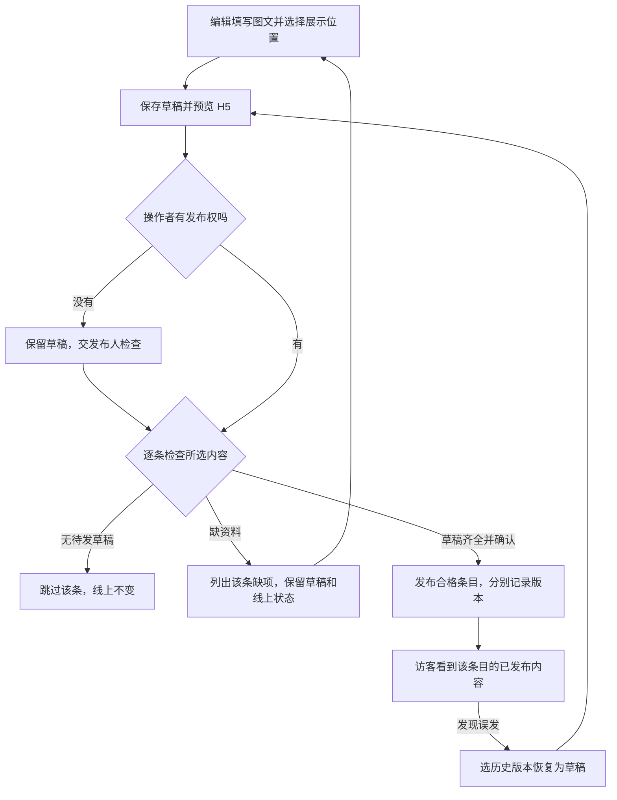

# 化妆品企业产品展示平台 V1 MVP PRD

## 一、用户故事

### 1.1 用户故事

- 作为企业业务人员，我想把一个 H5 链接发给客户，让客户不登录就能查看我可以公开介绍的产品、案例和合作方式。
- 作为品牌客户，我想在当前业务板块找到合适的产品，查看功效、成分和配方编号，以便联系企业时能说清是哪一款。
- 作为内容编辑，我想按页面位置换海报、填资料、配分类和二维码，先看到手机上的效果，再交给有发布权的人上线，不需要找研发改页面。我也想一次给多款产品追加展示分类，不必逐款打开。
- 作为发布人，我想知道每款草稿与线上内容的区别、缺什么以及发布会影响哪里；多款一起检查时，只发布其中合格的草稿，发错一款也能单独找回原来的正确版本。
- 作为企业管理员，我想自己开停后台账号、分配发布权，并能查到是谁发布了内容或改了权限。

### 1.2 业务问题与预期目标

**结论：固定版式，企业维护内容。** 用微肽的配置，应能还原[移动端定稿](../../../docs/cosmetics-platform-design-spec/prototype/index.html)；换另一家企业，不改前端也能使用自己的业务板块、产品、图片、案例和联系方式。具体视觉与交互以[设计稿细则](../../../docs/cosmetics-platform-design-spec/docs/设计稿细则与需求汇总.md)为依据，后台业务规则以已确认的需求为依据。编辑从产品或案例列表找到要维护的条目，发布人按条检查并决定是否上线。清理不用的内容时，要区分从未发布的草稿和有发布历史的条目，以免误删线上内容或丢失历史。

| 如何阅读定稿 | 判定方法 | 示例 |
|---|---|---|
| 定稿展示规则 | 换一家企业仍然成立 | 四个底部入口及顺序不变；服务区位于联系区上方；产品详情只展示一张详情长图。 |
| 后台可配置项 | 编辑可以填写、上传、选择或排序，不需要改页面 | 企业封面标语、长图、目录名称与图标、产品分类位置、案例介绍和商务二维码。 |
| 微肽示例值 | 用于复现设计，不是所有企业的默认事实 | 五个板块、四张首页海报、示例配方编号和模拟生产状态。不能当作另一家企业的资料发布。 |

**本次范围**：每家企业独立使用一套 H5 和 PC 管理后台。V1 验收从运营存草稿到客户在 H5 看到发布版的全过程。“产品管理 → 全部产品”和“品牌案例 → 全部案例”分别提供新增草稿、查找、编辑、单条发布检查、发布和下架。编辑可删除从未发布的草稿，发布人可归档已下架且有发布历史的条目。仅产品支持批量追加展示分类、批量检查并发布所选的合格草稿。V2 再接入小程序，复用届时已发布的内容；V1 不开发或验收小程序、不做分端发布。V1 不做跨企业切换、自由搭页、购物下单、意向清单或咨询线索登记。客户扫码后的沟通不在平台内流转。

## 二、核心业务流程

**现状流程**：现有交付包演示了访客浏览、搜索、查看详情和打开联系弹层的过程。资料来自示例或已交付海报；更换示例内容并不等于运营能在后台发布。目前没有可沿用的 PC 内容管理流程。

**目标流程**：企业管理员给同事开通编辑或发布权限。编辑准备资料，选择展示位置，在 PC 查看 H5 草稿效果。发布人可按条发布内容，也可从“全部产品”勾选多款，查看逐款检查结果，再确认发布其中合格的草稿。访客只看到本企业已发布的版本。发错一款，可单独恢复该款旧版本为草稿，再决定是否发布。

**变化与影响**：H5 保留定稿的页面结构和浏览方式，改为展示各企业已发布的资料。PC 后台是新增范围：编辑能存草稿但不能越权上线；发布人负责上线、下架和纠错；管理员负责账号及授权。企业微信只作为企业提供的联系方式展示，打开联系弹层不表示产生一条咨询记录。

## 三、功能需求

### 3.1 企业页面配置与首页海报

#### 3.1.1 功能说明

编辑按 H5 展示位置找内容，而不是面对一堆不知道用在哪里的图片。后台使用访客熟悉的四个页面名称。配置不允许增加第五个底部入口，也不改变页面区域顺序。

| 后台编辑位置 | 运营维护什么 | H5 在哪里核对 |
|---|---|---|
| 首页 → 长图轮播 | 上传、替换和排列竖版海报 | 进入首页直接看图，不增设独立企业名、标识栏或数据条。 |
| 产品目录 → 目录封面 | 横版封面、上下两行标语；图片已带字时避免再叠同样的文字 | 目录页搜索栏上方；预览时检查主体与字是否被裁切。 |
| 品牌案例 | 在页头维护顶部背景和标题说明，在“全部案例”维护案例图文 | 案例页页头、重点横卡、更多案例和详情，见 3.4。 |
| 联系我们 → 服务与商务联系 | 引导文案、服务卡片、二维码和已提供的联系方式 | 服务列表、独立联系区及联系弹层，见 3.5。 |

**业务规则**：底部顺序固定为“首页、产品目录、品牌案例、联系我们”。沿用白底、浅蓝点缀、可编辑文字黑色。上传图片内的文字和颜色保留原样。首页正式配置至少三张海报；微肽定稿为四张，不将四张设为全平台上限。

#### 3.1.2 交互逻辑

**业务状态与流转**：页面内容的草稿、发布、恢复见 3.6。编辑替换一张海报或调整顺序时，先核对草稿效果，不能因为上传成功就替换线上内容。

**页面与操作映射**：H5 首页长图全宽等比显示，不裁切瓶身或文案；正常每 4 秒切换。点圆点或横滑可换图；按住、向下阅读长图或离开页面时暂停。回到顶部或重新进入并满足播放条件时恢复。底部导航独立于长图滚动。

#### 3.1.3 异常处理

| 异常场景 | 触发条件 | 系统处理方式 | 用户提示 |
|---|---|---|---|
| 海报不足 | 准备发布的正式轮播少于三张 | 可以存草稿；发布检查指出不足，不以示例图补齐 | 编辑看到现有张数，可继续上传 |
| 无图或只剩一张可展示 | 访客打开的内容没有可展示海报，或仅有一张 | 无图不留坏图和多余圆点；一张静态展示，不空转 | 其余导航仍可用 |

#### 3.1.4 原型

- 原型入口：[已定稿的移动端原型](../../../docs/cosmetics-platform-design-spec/prototype/index.html)，选择“首页”。
- 演示范围：长图轮播、圆点、阅读暂停及底部导航。
- 已确认结论：上传的海报就是首页主体，不额外叠加企业介绍。
- 未覆盖范围：该原型不演示 PC 内容编辑和发布。

### 3.2 业务板块、分类与目录浏览

#### 3.2.1 功能说明

运营为本企业组织目录，访客按业务板块、分类和细分类查找产品。产品独立于目录；目录决定“在哪里展示”，不负责保存另一份产品资料。

**业务规则**：企业可新增、改名、换图标、排序和停用一级板块。微肽验收配置按“护肤、冻干、二类、洗护、外贸”排列，采用定稿的 43 个分类；这不是其他企业的固定数量。分类及细分类名称、顺序和展示的产品按本企业业务维护。没有细分类时只显示“全部”。

#### 3.2.2 交互逻辑

**业务状态与流转**：编辑在“产品目录 → 板块与分类”维护目录；线上变更遵守 3.6。停用板块后，该入口不再对外展示，不因此删除产品。移除一处产品展示位置后，其余有效位置仍引用同一款产品。

**页面与操作映射**：目录封面下依次为搜索栏、板块、左侧分类、右侧筛选与列表。数量放在右侧筛选行末端，表示当前分类的全部产品数，不随细筛选改变；占位记录与案例不计数。列表只展示方图、名称和短功效，不在列表展示配方编号。

搜索限当前板块，按产品名、英文名、配方编号、分类或细分类名称匹配，不承诺成分全文搜索。搜索时隐藏细筛选并单独显示命中数。清空搜索恢复之前的分类与细筛选；切换板块或从详情返回时，在本次浏览中保留原有位置。

#### 3.2.3 异常处理

| 异常场景 | 触发条件 | 系统处理方式 | 用户提示 |
|---|---|---|---|
| 空分类或搜索无结果 | 当前范围无已发布的匹配产品 | 保留目录结构，不造占位产品；搜索可清空 | 区分“该分类暂无展示产品”和“没有找到相关产品” |
| 示例归类不明 | 交接资料中七条旧示例尚未归入新分类 | 不凭名称替企业决定归类，不作为正式交付资料自动上架 | 编辑核对企业正式资料后选择展示位置 |

#### 3.2.4 原型

- 原型入口：[移动端定稿](../../../docs/cosmetics-platform-design-spec/prototype/index.html)，选择“产品目录”。
- 演示范围：板块切换、左右分类、细筛选、搜索与返回。
- 已确认结论：保留浏览行为；五个板块及其内容是微肽配置。
- 未覆盖范围：企业配置目录和跨分类引用产品由本次访谈确认。

### 3.3 产品资料、展示位置与下架

#### 3.3.1 功能说明

编辑只维护一份产品资料，再选择一个或多个展示位置。例如同一款精华液出现在“护肤”和“外贸”时，两处展示同一个已发布版本。

**业务规则**：表单按用途分组：列表资料为方图、名称和短功效；详情资料为横版封面、名称、功效、核心成分、产品亮点、配方编号、是否生产过，以及一张详情长图。可填写英文名供搜索。正式资料和图片必须属于同一产品；生产情况未知时显示“待确认”，不得将猜测写成“已生产”。缺少定稿必填内容（如详情长图）不允许发布。

#### 3.3.2 交互逻辑

**业务状态与流转**：编辑存草稿、发布人发布。已发布产品有新草稿时，原版继续对外展示。下架前，后台列出关联案例，说明只下架产品；发布人可取消或确认。确认后，产品退出所有目录与产品搜索，后台保留资料和版本，案例及其他产品不变。

**页面与操作映射**：在 PC 后台进入“产品管理 → 全部产品”。每款产品只列一行，即使它出现在多个分类。编辑可新增产品并保存为草稿，也可按产品名称或配方编号搜索，按展示分类、线上状态和是否有草稿筛选。找到产品后，从该行打开编辑；发布人可在该行检查并发布这款产品，或下架其线上版，无需勾选批量操作。删除草稿与归档的条件见 3.6。

勾选多款产品并选择要追加的展示分类后，编辑只保存草稿：在每款现有草稿上追加，没有草稿的从现有资料开始；保留原有分类和其他资料，已有的分类不重复添加。此操作不发布，也不改变线上展示。发布人可以另选待发产品检查，见 3.6。

从列表打开一款产品，编辑页依次提供“资料、展示分类、H5 预览、发布检查”。在展示分类区域可以核对板块和完整分类路径。在预览中先看列表卡片，再核对详情：返回栏、16∶9 封面、六项信息、详情长图。访客可复制配方编号，再返回原列表位置；不展示购买栏。

#### 3.3.3 异常处理

| 异常场景 | 触发条件 | 系统处理方式 | 用户提示 |
|---|---|---|---|
| 新图未就绪 | 必填图未上传或上传未成功 | 不用示例图顶替；定位缺项，线上保留原版或继续不上线 | 编辑补图、预览后，再交发布人核对 |
| 复制不成功 | 访客点击配方编号但没有完成复制 | 展示可选中的编号文本，不误报成功 | 提示长按或手动复制 |
| 产品有关联案例 | 发布人要下架产品，或归档已下架的产品 | 操作前列出关联案例；取消则不变。确认只处理产品，不删除或下架任何案例 | 显示涉及的案例名称；案例保留各自的状态 |

#### 3.3.4 原型

- 原型入口：[移动端定稿](../../../docs/cosmetics-platform-design-spec/prototype/index.html)保留访客详情；后台可对照[产品资料正式设计稿](../../../docs/admin-wireframes.html#product)。[PC 交互原型](prototype.html)仅供本地评审，进入“产品管理 → 全部产品”。
- 演示范围：移动端看详情、复制编号并返回；后台从列表核对单款的草稿、发布和清理操作，以及多选追加分类与批量发布的区别。
- 已确认结论：一张详情长图按原比例展示；配方编号属于公开详情。追加分类只改所选产品的草稿。
- 未覆盖范围：本地模拟不证明真实资料已保存或线上分类已更新。

### 3.4 品牌案例

#### 3.4.1 功能说明

编辑可以独立介绍一项真实合作，包括不进入公开产品目录的定制项目。案例维护自己的客户品牌、产品名称、简短亮点、图片和系列介绍，不用目录产品名替换客户授权对外使用的名称。

**业务规则**：案例可选关联后台产品，不关联也可以按条发布。关联只供后台识别合作关系，不增加访客跳转，也不把产品改名、换图或下架自动同步到案例图文。

#### 3.4.2 交互逻辑

**业务状态与流转**：编辑维护案例草稿、案例分类和展示次序；发布人确认后进入相应筛选结果。案例自己的发布、下架和恢复独立于关联产品。

**页面与操作映射**：在 PC 后台进入“品牌案例 → 全部案例”。编辑可新增案例并存为草稿，也可按品牌名或案例中的产品名查找，打开对应行编辑。发布人从该行单独检查并发布案例，或下架其线上版。删除草稿与归档见 3.6。

在 H5 上，微肽按定稿展示“精选案例、冻干案例、二类案例、外贸案例”。“精选案例”是全部已发布案例的浏览入口，不另设精选选品流程。当前结果第一条为重点横卡，只放品牌名、产品名、简短亮点；其余双列展示。点卡片查看定稿的案例详情，重点卡的三项限制不用于裁剪详情内容。

H5 案例搜索在当前筛选范围内匹配品牌名、产品名、亮点和描述。点清空或“重新查找”回到精选；手动删空文字保留当前筛选，与目录搜索区分。

#### 3.4.3 异常处理

| 异常场景 | 触发条件 | 系统处理方式 | 用户提示 |
|---|---|---|---|
| 后台查不到案例 | “全部案例”中没有匹配品牌名或产品名的条目 | 显示查找无结果，不改变案例内容或状态 | 编辑可修改或清空关键词再查 |
| 结果不足以组成网格 | 当前结果只有一条或为空 | 一条只显示重点卡；零条显示空态，不显示空网格标题 | 无结果可重新查找 |
| 没有对应的公开产品 | 案例介绍定制服务或关联产品已下架 | 保留案例自己已发布的图文，不出现失效产品链接 | 访客可正常查看案例；运营另行决定是否下架 |

#### 3.4.4 原型

- 原型入口：[移动端定稿](../../../docs/cosmetics-platform-design-spec/prototype/index.html)选择“品牌案例”；[PC 交互原型](prototype.html)仅供本地评审，进入“品牌案例 → 全部案例”。
- 演示范围：访客筛选、搜索并打开案例；后台从案例列表核对草稿新增、查找、编辑，以及单条发布、下架和清理操作。
- 已确认结论：案例展示产品合作事实，不以未经证实的业绩数字作装饰。
- 未覆盖范围：本地演示不能证明真实发布、下架或归档已生效，也不能替代对关联案例状态的核对。

### 3.5 服务卡片与商务联系方式

#### 3.5.1 功能说明

企业先向客户说明能提供的服务，再给出联系渠道。编辑可替换各处引导文案、增减服务卡片并调整卡片顺序，不得移动服务区与联系区的相对位置。

**业务规则**：服务图片按原比例展示，可打开大图；商务二维码单独上传，不能合成在每张服务图中。微信号、电话和邮箱按企业实际提供的内容展示。微肽样例的服务能力、示意二维码都不是正式资料。

#### 3.5.2 交互逻辑

**业务状态与流转**：服务卡片和商务联系内容可分别维护。更换联系方式先存草稿，核对预览后发布；恢复和误发处理见 3.6。

**页面与操作映射**：PC 编辑页按 H5 的阅读顺序呈现“服务说明、服务卡片、商务联系”。H5 底部入口叫“联系我们”，页内标题为“服务与合作”。“合作咨询”和“查看二维码”打开同一个联系弹层。配置真实二维码时可放大、保存；配置微信号时可复制。关闭服务图或弹层后返回原页面。

#### 3.5.3 异常处理

| 异常场景 | 触发条件 | 系统处理方式 | 用户提示 |
|---|---|---|---|
| 缺少可选联系方式 | 企业没有提供某项微信号、电话或邮箱 | 隐藏对应操作，不用假号码凑齐 | 访客只看到可用入口 |
| 缺少真实二维码 | 没有上传可用二维码 | 不展示伪装成可扫码的示意图，不提供无效的保存操作 | 编辑在预览中能识别缺少的素材 |

#### 3.5.4 原型

- 原型入口：[移动端定稿](../../../docs/cosmetics-platform-design-spec/prototype/index.html)，选择“联系我们”。
- 演示范围：服务卡片、服务图预览、独立联系区和联系弹层。
- 已确认结论：服务图和二维码分开维护，两处联系入口指向同一份对外联系内容。
- 未覆盖范围：真实扫码结果、后台换码和版本恢复不由示意图证明。

### 3.6 PC 工作台、预览、发布与版本恢复

#### 3.6.1 功能说明

编辑要知道“改哪里、客户会看到什么”，发布人要知道“这次会替换哪些内容、哪些保持不变”。工作台提供页面配置、板块与分类、产品资料、品牌案例、服务与联系入口；账号管理与关键记录按权限开放。它不是一套可以随意移动页面组件的装修工具。

**业务规则**：批量发布只影响本次勾选、确有待发草稿且资料合格的产品，不是整站发布。每款产品发布自己的完整图文和展示分类，不能只上线新文字、保留尚未确认的旧配图。产品被多个分类引用时，各处读取同一个已发布版本。草稿和历史版本都不能通过公开 H5 链接访问。

#### 3.6.2 交互逻辑

**业务状态与流转**：

| 内容状态 | 编辑和发布人能做什么 | 访客看到什么 |
|---|---|---|
| 首次草稿 | 编辑可以分次保存、预览；发布人检查并发布 | 新内容不可见 |
| 已发布，无新草稿 | 查看线上版本；编辑可开始下一次修改，发布人可下架 | 当前发布版 |
| 已发布，另有草稿 | 预览时标明草稿；发布人可核对缺项与影响位置，决定是否发布 | 未确认发布前仍显示旧版 |
| 已下架 | 后台仍能查看资料和历史；需再次按发布规则处理才对外展示 | 不再公开展示该条内容 |
| 恢复历史版本为草稿 | 选择明确版本并确认恢复，预览、检查后由发布人重新发布 | 恢复动作本身不改变线上内容 |

**页面与操作映射**：内容列表区分“线上状态”和“是否有草稿”，不将已上线且正在编辑的条目简单写成“未发布”。编辑页标明当前对象与展示位置；草稿预览与线上查看分开。发布检查列出影响位置和具体缺项，可返回对应编辑位置。发布成功后能辨认本次线上版本并在 H5 核对。版本记录中可查看历史内容、操作人和时间，恢复不覆盖其他条目。

在“全部案例”或“全部产品”，发布人从目标行打开发布检查。检查不改变线上内容；有待发草稿且资料合格，确认后只发布这一条。已有线上版的条目可由发布人从该行下架。

两个列表的清理规则相同：

- **从未发布的草稿**：编辑从该行选择删除，核对条目并二次确认后才删除；取消则保留草稿。
- **仍在线上**：不能直接删除或归档，即使另有草稿也一样。发布人要将条目退出日常列表，须先下架。
- **已下架且有发布历史**：不允许删除。发布人可归档；归档后条目退出日常列表，不再公开，保留版本和操作日志。归档产品前列出关联案例，不连带删除或下架案例。

仅发布人可在“全部产品”发起批量发布检查并查看逐款结果。勾选后，检查清单逐款列出产品名称、配方编号和结论：可发布、缺哪些资料，或没有待发草稿。检查本身不发布。确认按钮按可发布款数命名，如“发布这8款”，而不是按勾选总数命名；没有合格款时不能确认发布。

发布后，清单逐款说明是否已发布；未发布的保留原状并注明原因。每款成功发布的产品都有自己的发布版本和日志，发布人可单独恢复其中一款为草稿，其他产品的草稿和线上版本都不变。

#### 3.6.3 异常处理

| 异常场景 | 触发条件 | 系统处理方式 | 用户提示 |
|---|---|---|---|
| 检查不通过 | 某款缺必填文案或图片 | 跳过该款，保留草稿；已有线上版继续展示，无线上版则不展示。不妨碍所选合格款发布 | 列出该款缺项，编辑补齐后可重新检查 |
| 没有待发草稿 | 选中产品只有线上版或没有新草稿 | 不重发、不产生发布版本；未勾选的产品也不参与检查或发布 | 所选无草稿的产品标明“没有待发草稿” |
| 单条不能发布 | 所选案例或产品无待发草稿，或检查发现缺项 | 不生成发布版本，保持线上状态和已有草稿 | 无草稿时说明原因；有缺项时列明，编辑补齐后重新检查 |
| 删除或归档条件不符 | 尝试删除有发布历史的产品或案例，或直接归档线上条目 | 拒绝操作，保留原条目及其历史 | 在线条目提示由发布人先下架；已下架且有历史的条目提示由发布人归档 |
| 无发布权 | 账号未获发布权，尝试批量检查、发布、下架或归档 | 不开放批量检查结果，不执行发布、下架或归档；有编辑权仍可维护草稿 | 告知由有发布权的人员操作 |
| 无法确定发布结果 | 操作中断，发布人未看到明确结果 | 不把提交动作显示为发布成功；可回到该条目核对线上版本与操作记录 | 先核对结果；未发布时再处理，不要求重录整条资料 |

#### 3.6.4 原型

- 原型入口：[PC 后台正式设计稿：内容工作台](../../../docs/admin-wireframes.html#desk)；[PC 交互原型](prototype.html)仅保留在本地，不随项目提交，用于评审两个列表的单条操作，以及“全部产品”的批量发布结果。
- 演示范围：从[产品资料与 H5 草稿](../../../docs/admin-wireframes.html#product)查看同一产品的两处展示位置，经[发布检查](../../../docs/admin-wireframes.html#release)核对缺项与线上差异，再对照[下架与版本恢复](../../../docs/admin-wireframes.html#history)的影响。
- 已确认结论：用户已确认批量发布仍按产品分别校验、发布和记录版本；正式设计稿保留单条操作参考。
- 未覆盖范围：正式设计稿和本地模拟都不代替真实的权限、发布与恢复验收。

### 3.7 企业账号、权限与操作记录

#### 3.7.1 功能说明

企业负责人自行给同事开通和停用后台账号，不依赖交付人员处理日常入职、离职或发布授权。访客不占后台账号，转发 H5 链接不会传递后台权限。

**业务规则**：区分账号管理、内容编辑、内容发布三类职责。普通编辑只维护草稿；有发布权的人可发布自己或他人的修改，不强制双人审批；仅企业管理员能管理账号、授予或收回发布权。管理员身份本身不授予发布权；未获发布权时，也不能批量检查或发布产品。关键操作留痕范围见 4.3。

#### 3.7.2 交互逻辑

**业务状态与流转**：管理员开通账号后，同事按已授予的权限工作。收回发布权后不能再发布；停用账号后不能再使用后台。这些变更不会让该人员过去发布的内容自动下架。

**页面与操作映射**：管理员在账号列表辨认账号状态和发布权，进入指定账号后执行开通、停用或授权变更。内容记录按条目定位发布、下架和恢复事件，也能查到产品或案例的草稿删除和归档记录，账号记录按目标账号定位权限变化。两类记录都能回答“何人、何时、对什么对象做了什么”。

#### 3.7.3 异常处理

| 异常场景 | 触发条件 | 系统处理方式 | 用户提示 |
|---|---|---|---|
| 编辑试图给自己加权 | 非管理员请求变更账号权限 | 拒绝变更，权限保持原样 | 联系企业管理员 |
| 已失去权限但页面尚未关闭 | 被停用或被收回发布权的人员继续操作 | 以实际有效权限拒绝操作，不改变线上版本 | 告知账号状态或权限已变化 |

#### 3.7.4 原型

- 原型入口：[PC 后台正式设计稿：账号与操作记录](../../../docs/admin-wireframes.html#accounts)。
- 演示范围：账号的启用状态与发布权分列；可对照编辑、发布人和管理员的职责，以及内容发布、开通账号和授权的记录示例。
- 已确认结论：企业自己管理账号，权限和审计限定在本企业。
- 未覆盖范围：原型不能证明停用、撤权或访问限制已经生效。

## 四、非功能需求

### 4.1 性能要求

- 接口响应时间：V1 未约定定量响应时限。验收关注真实手机上的浏览：海报加载不阻断底部导航；上传、保存与发布各自给出与实际结果相符的反馈。
- 并发用户数：未指定并发指标，不将示例企业的访问量写成全平台承诺。
- 数据量边界：不将样例图数、板块数或产品数设为全平台上限。按定稿的窄屏、长图、长名称、多分类与空结果场景验收；底部导航不挡住最后一项内容。

### 4.2 安全需求

- 权限设计：公开 H5 无需登录。企业发布前应确认配方编号、成分、客户名称和图片均可公开；转发链接不会降低或提高可见范围。
- 权限校验：对预览或删除草稿、批量发布检查、发布、下架、归档和账号管理分别核对当前权限。隐藏按钮不能替代拒绝无权操作；直接打开公开地址也不得读取草稿或下架内容。
- 数据安全：每家企业独立管理资料、账号与记录。不能拿其他企业资料或微肽演示素材填补本企业空缺。仅展示企业提供的联系方式，不因浏览联系弹层自动收集访客线索。

### 4.3 操作日志记录

| 操作 | 是否记录日志 | 记录信息 |
|---|---|---|
| 发布或下架内容 | 是 | 操作人、时间、条目、操作类型、涉及版本；批量发布也给每款成功发布的产品单独记一条发布记录 |
| 删除从未发布的产品或案例草稿 | 是 | 操作人、时间、所删条目和删除结果 |
| 归档已下架的产品或案例 | 是 | 操作人、时间、条目和归档结果；历史版本及原操作日志保留 |
| 恢复历史版本为草稿 | 是 | 操作人、时间、条目、恢复来源版本；与后续重新发布区分 |
| 开通或停用账号 | 是 | 管理员、时间、目标账号、操作类型 |
| 授予或收回发布权 | 是 | 管理员、时间、目标账号、权限变更方向 |
| 每次改字、保存草稿 | 否 | 可继续编辑当前草稿，不要求逐次追溯编辑过程 |

## 五、测试建议

| 场景 | 前置条件 | 操作 | 预期结果 |
|---|---|---|---|
| 微肽基线还原 | 准备与定稿对应的演示资料 | 配置企业内容后依次查看四个入口 | 四页顺序、五板块与 43 类按定稿展示；首页四张海报、详情六项信息和一张长图，无旧首页标题栏或意向清单 |
| 第二家企业独立使用 | 企业没有微肽业务板块 | 配置“护肤、彩妆、香氛”及自己的封面、服务卡、二维码 | 不改页面即可展示三个板块及本企业资料，无微肽标语、产品或联系方式残留 |
| 产品跨分类发布 | 一款已发布精华液在护肤与外贸均有展示 | 编辑修改功效、移除必填长图，保存；发布人尝试发布，再补齐发布 | 初次检查指出缺图，两处均显示旧版；成功后两处图文同时使用同一发布版 |
| 新品资料不齐 | 尚无线上版本 | 保存缺图的新品草稿，由发布人检查 | 草稿保留，新品在目录、搜索和公开详情均不可见 |
| 全部产品查找 | 一款精华液有两个展示分类，已上线且有草稿 | 分别用名称、配方编号搜索，再组合分类、线上状态和草稿筛选 | 任一所属分类都能找到该款；结果始终只占一行，不符合筛选条件的产品不出现 |
| 两个列表各自维护一条 | 编辑和发布人分别有相应权限；各列表另有一条合格草稿 | 从两处列表各新增草稿；案例分别按品牌名和产品名查找，产品分别按名称和配方编号查找；编辑并保存，再由发布人从该行检查、确认发布 | 新增、编辑和检查都不改变 H5；确认后仅目标条目上线，其他草稿不变，发布记录可查 |
| 删除未发布草稿 | 两个列表各有从未发布的草稿 | 编辑分别发起删除，先取消，再二次确认 | 取消后草稿仍可编辑；确认后草稿从对应列表消失，记录能辨认所删条目与操作人 |
| 下架后归档而非删除 | 产品和案例各有线上版，产品关联至少一个已发布案例 | 尝试直接删除或归档线上条目；发布人下架产品后尝试删除，再归档；从案例行下架并归档另一条案例 | 线上不能直接删除或归档，下架后仍不能删除。产品归档前列出关联案例，归档后关联案例仍可访问；归档的产品和案例均退出各自日常列表，历史版本、日志可查 |
| 批量追加展示分类 | 甲、乙有不同的原分类；甲已有目标分类，乙有未发布的文字修改；另有未勾选的丙 | 编辑勾选甲、乙，追加同一分类并保存草稿，再重复追加 | 甲没有重复分类；乙保留原分类和文字修改，新增分类也只有一处。丙不变，三款线上展示均不变 |
| 只发布合格款 | 勾选的产品中有八款合格草稿，另有缺图但已上线的产品和没有待发草稿的产品；另留一款合格草稿不勾选 | 发布人先检查清单，对照逐款结论和缺项，再点“发布这8款” | 检查时线上不变；确认后仅八款各自产生新版本及发布记录。缺图款保留旧线上版和待补草稿；无草稿款与未选款不变。若只选不可发布款，则不能确认发布 |
| 批量发布后只纠正一款 | 同批发布的甲、乙均有历史版本 | 从甲的记录选择旧版本，恢复为草稿 | 仅甲出现恢复草稿及恢复记录；甲、乙线上版均不回退，乙的草稿及记录不变 |
| 目录计数和返回 | 一类有三款，其中一种细分类只有一款 | 选中该细分类，打开详情再返回；在板块内搜索后清空 | 右侧数量仍是三款，筛选结果仅一款；返回位置保留，清空后恢复原筛选 |
| 产品下架与案例 | 有案例引用同一款在两个板块展示的产品 | 发起下架先取消，再确认下架 | 取消不改线上；确认后两处及搜索均不可见，案例图文继续公开，无失效产品跳转 |
| 独立案例 | 某定制合作没有目录产品 | 单独发布案例并查看案例页 | 案例可见且不生成目录产品；只有一条结果时不显示空网格 |
| 误发二维码 | 已发布过正确和错误的两个版本 | 查发布人，将正确版本恢复为草稿；扫码核对后重新发布 | 恢复时 H5 不变；重新发布后联系区和弹层均使用正确二维码，其他内容不回退 |
| 权限和撤权 | 有普通编辑、发布人和未获发布权的企业管理员 | 编辑尝试自行加权；编辑和管理员分别尝试批量检查、发布和归档已下架条目；发布人发布自己的修改后，由管理员撤权 | 编辑不能自行加权；编辑和未获发布权的管理员均不能查看批量检查结果、发布或归档。有发布权时不强制二审，撤权后不能再检查或发布；管理员可查授权记录 |
| 公开访问与草稿隔离 | 产品有线上版和更新的草稿版 | 后台预览草稿；用未登录手机打开并转发公开链接 | 客户无需登录即可浏览线上版及配方编号，两位访客均看不到草稿或后台操作 |
| 手机浏览回归 | 使用窄屏手机及长海报、长服务图 | 阅读首页长图、切页、看服务图和联系弹层、返回 | 阅读时轮播暂停；图片等比、导航可用；未配置的可选联系操作不出现 |

## 六、待确认问题

- 各企业正式海报、产品功效与生产状态、客户授权图文、真实二维码由企业在上线前核对。素材到齐时间不影响后台规则和页面设计，但不能用演示资料代替正式发布验收。
- 微肽交接包中的七条未归类示例，由企业决定保留、替换或不展示。它们不影响独立产品资料与目录引用规则，不作为必须上线的产品。
